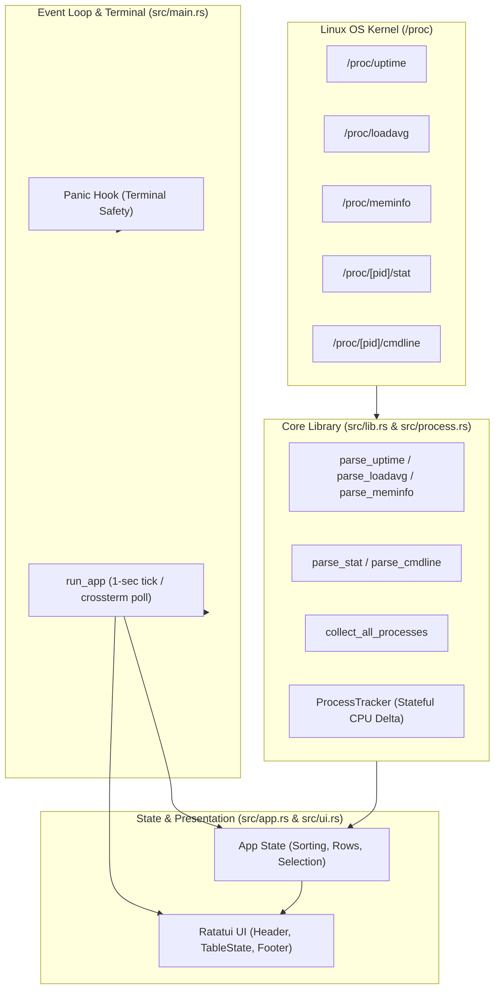

# Linux Process Visualizer (`linux_process_visualizer`)

[](https://www.rust-lang.org)
[](https://kernel.org)
[](https://ratatui.rs)
[]()
[](LICENSE)

A high-performance, real-time interactive terminal process viewer and system monitor built from scratch in **Rust** using Linux kernel pseudo-filesystems (`/proc`), [`ratatui`](https://ratatui.rs), and [`crossterm`](https://github.com/crossterm-rs/crossterm).

Inspired by tools like `htop` and `top`, this project emphasizes **zero-copy slicing**, **resilient systems programming**, and **terminal crash safety**.

---

## TUI Showcase

```text
┌─ System Overview ────────────────────────────────────────────────────────────┐
│ Uptime: 3d 14h 22m 10s  |  Load Avg: 0.45, 0.52, 0.48                         │
│ Memory: 4.8 GB / 15.8 GB (30.4%)                                             │
└──────────────────────────────────────────────────────────────────────────────┘
┌─ Processes (184) ────────────────────────────────────────────────────────────┐
│ PID      NAME             STATE    CPU% ▼   MEM        THREADS  CMDLINE      │
│ >> 2341  rust-analyzer    Sleeping 14.8%    342.1 MB   16       rust-analyzer│
│    1890  alacritty        Sleeping  5.2%    112.5 MB   8        alacritty    │
│    4512  cargo            Running   4.1%     95.3 MB   4        cargo test   │
│    1     systemd          Sleeping  0.0%     12.4 MB   1        /sbin/init   │
│    2     kthreadd         Sleeping  0.0%      0 B      1        [kthreadd]   │
└──────────────────────────────────────────────────────────────────────────────┘
┌─ Controls ───────────────────────────────────────────────────────────────────┐
│  [q] Quit   [s] Sort: CPU% (desc)   [↑/k] Up   [↓/j] Down                    │
└──────────────────────────────────────────────────────────────────────────────┘
```

---

## Key Features

- **Direct `/proc` Kernel Telemetry**:
  - `/proc/uptime`: Real-time system uptime with humanized formatting (`X days, Y hours...`).
  - `/proc/loadavg`: 1, 5, and 15-minute system load averages.
  - `/proc/meminfo`: Memory metrics (Total, Available, Used KB, and percentage).
  - `/proc/<pid>/stat`: CPU ticks (`utime`, `stime`), process state, RSS memory pages (`4096` bytes per page), and thread count.
  - `/proc/<pid>/cmdline`: Null-byte (`\0`) delimited argument tokenization with graceful kernel thread fallback (`[kthreadd]`).

- **Two-Sample Delta CPU% Engine**:
  - Calculates true instantaneous CPU load using consecutive temporal snapshots:
    $$\Delta \text{CPU\%} = \frac{\Delta \text{ticks}}{\text{CLK\_TCK} \times \Delta t} \times 100$$
  - Uses `Instant::now()` and `std::time::Instant` elapsed intervals.
  - Applies `.saturating_sub()` to protect against counter wrap-around or clock skew underflow panics.

- **Vanishing Process Resilience**:
  - Handles ephemeral Linux processes that terminate between directory scanning and reading without failing or panicking (`if let Ok` pattern).
  - Automatically cleans up vanished PIDs from cache via `HashMap::retain`.

- **Declarative Interactive TUI**:
  - Built with modern **Ratatui 0.30**.
  - Dynamic multi-column sorting: **CPU%** (descending), **Memory** (descending), **PID** (ascending), or **Name** (case-insensitive alphabetical).
  - Smooth viewport scrolling powered by `TableState`.

- **Terminal Raw Mode Crash Safety**:
  - Configures a custom panic hook with `std::panic::set_hook`.
  - Guarantees the terminal leaves raw mode and exits the alternate screen buffer even if the program panics, preventing shell corruption.

---

## Keyboard Controls

| Key | Action | Description |
| :--- | :--- | :--- |
| **`q`** | **Quit** | Exits the event loop and restores terminal state cleanly |
| **`s`** | **Cycle Sort** | Cycles sort column: `CPU%` $\rightarrow$ `MEM` $\rightarrow$ `PID` $\rightarrow$ `NAME` |
| **`↑`** or **`k`** | **Navigate Up** | Moves the selected process row cursor upward |
| **`↓`** or **`j`** | **Navigate Down** | Moves the selected process row cursor downward (clamped) |

---

## Architecture

The project adheres to the **Pure Functional Core, Imperative Shell** pattern:



### Module Breakdown

- [`src/lib.rs`](src/lib.rs): System statistics parsers (`parse_uptime`, `parse_loadavg`, `parse_meminfo`), formatting helpers (`format_uptime`, `format_kb`), and `SystemOverview`.
- [`src/process.rs`](src/process.rs): Process stat parsing, name isolation with parenthesized string boundaries (`rfind`), `/proc` directory scanning, and `ProcessTracker`.
- [`src/app.rs`](src/app.rs): TUI application state (`App`), `SortColumn` enum, `ProcessRow`, navigation clamping, and sorting algorithms.
- [`src/ui.rs`](src/ui.rs): Declarative layout partitioning and widget rendering (`render_header`, `render_table`, `render_footer`).
- [`src/main.rs`](src/main.rs): Terminal setup (raw mode, alternate screen), panic hook installation, and the 1-second event loop.

---

## Getting Started

### Prerequisites

- A Linux operating system (Ubuntu, Debian, Fedora, Arch, WSL2, etc.).
- [Rust toolchain](https://rustup.rs/) (edition 2024 or 1.80+).

### Installation & Running

1. **Clone the repository**:
   ```bash
   git clone https://github.com/123EFD/linux_process_visualizer.git
   cd linux_process_visualizer
   ```

2. **Run in development mode**:
   ```bash
   cargo run
   ```

3. **Build optimized release binary**:
   ```bash
   cargo build --release
   ./target/release/linux_process_visualizer
   ```

---

## Testing

The project includes an extensive test suite covering parsing edge cases, memory units, two-sample CPU math, navigation clamping, and sorting behaviors:

```bash
cargo test
```

```text
running 28 tests
test app::tests::test_app_navigation_clamping ... ok
test app::tests::test_app_quit ... ok
test app::tests::test_sort_column_cycle ... ok
test app::tests::test_sort_processes_and_cycle ... ok
test process::tests::test_cpu_calculation_two_samples ... ok
test process::tests::test_list_pids_finds_processes ... ok
test process::tests::test_parse_cmdline_kernel_thread ... ok
test process::tests::test_parse_cmdline_multiple_args ... ok
test process::tests::test_parse_cmdline_trailing_nulls ... ok
test process::tests::test_parse_invalid_stat ... ok
test process::tests::test_parse_name_with_spaces_and_parentheses ... ok
test process::tests::test_parse_simple_stat ... ok
test process::tests::test_process_memory_helpers ... ok
test process::tests::test_process_state_from_char ... ok
test tests::test_format_kb ... ok
test tests::test_format_uptime ... ok
test tests::test_parse_empty_uptime ... ok
test tests::test_parse_incomplete_loadavg ... ok
test tests::test_parse_invalid_loadavg ... ok
test tests::test_parse_invalid_uptime ... ok
test tests::test_parse_missing_field_meminfo ... ok
test tests::test_parse_valid_loadavg ... ok
test tests::test_parse_valid_meminfo ... ok
test tests::test_parse_valid_uptime ... ok
test tests::test_system_overview_ownership_and_banner ... ok
test ui::tests::test_format_header_lines ... ok
test ui::tests::test_sort_label ... ok
test process::tests::test_collect_all_processes_non_empty ... ok

test result: ok. 28 passed; 0 failed; 0 ignored; 0 measured; 0 filtered out; finished in 0.28s
```

---

## Rust Systems Concepts Handbook

For an in-depth reference on Rust ownership, borrow checker mechanics, partial moves, and systems programming patterns applied throughout this project, see:

📖 **[`RUST_CONCEPTS_SUMMARY.md`](RUST_CONCEPTS_SUMMARY.md)** *(Formatted for easy Notion import)*.

---

## License

This project is licensed under the [MIT License](LICENSE).
